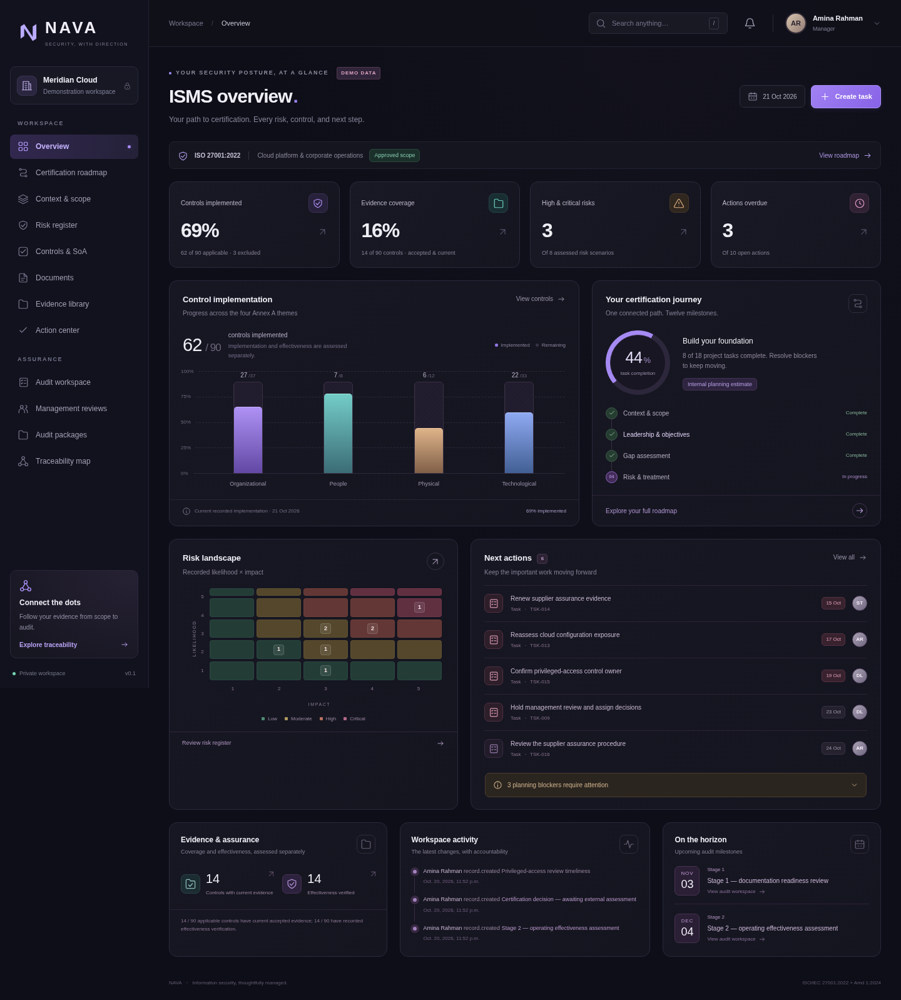

# NAVA · ISMS workspace

NAVA is a local Django workspace for planning and recording an ISO/IEC 27001 implementation. It connects scope, obligations, risks, treatment, controls, documents, evidence, approvals, and audits in a dark, responsive interface. The application name is configurable with `NAVA_APP_NAME`.

This delivery implements the Milestone 1 foundation and selected operational features: versioned records, business approvals, private evidence, traceability, frozen audit packages, exports, and backup/restore. The broader operational workflows remain in [the delivery checklist and continuation plan](docs/continuation.md). Records and internal readiness indicators support preparation; they do not issue or guarantee certification.



## Prerequisites

- Python **3.12.14** was used for Linux validation. Python 3.12 is the recommended Windows runtime.
- A local writable project folder, a browser, and Internet access to install the packages in `requirements.txt`.
- No Docker, cloud account, Redis, API key, or separately configured database.

Dependencies are pinned in [requirements.txt](requirements.txt). Django 5.2.18, SQLite, Waitress 3.0.2, and WhiteNoise 6.11.0 provide the core runtime. **Windows commands are provided, but Windows execution has not been tested in this Linux environment.**

## Install and launch on Windows 11

Open PowerShell in the project folder. Quoted paths containing spaces are supported.

```powershell
Set-Location "C:\Users\YourName\Projects\NAVA"
py -3.12 scripts/setup.py
```

Setup creates `.venv`, installs the pinned dependencies, creates a random private application secret, migrates the database, seeds framework references and role presets, and collects static assets. It asks whether to create the first administrator when run interactively. Setup does not create a fixed password or demonstration business records.

If administrator creation was skipped:

```powershell
.\.venv\Scripts\python.exe manage.py createsuperuser
```

Administrative access and business approval authority are separate. Explicitly assign the initial business roles to named accounts:

```powershell
.\.venv\Scripts\python.exe manage.py assign_role --username your-manager --role Manager
.\.venv\Scripts\python.exe manage.py assign_role --username your-approver --role Approver
```

Then launch the normal operational server:

```powershell
py -3.12 scripts/start.py
```

Open `127.0.0.1:8000` in the browser and sign in. The launcher binds only to the local host and runs **Waitress**, not Django's development server. Keep its terminal open. Press **Ctrl+C** to stop; run the same command to restart. See [operations](docs/operations.md) for preflight checks, recovery, updates, and troubleshooting.

## Linux/macOS commands

```sh
python3 scripts/setup.py --no-admin
.venv/bin/python manage.py createsuperuser
.venv/bin/python manage.py assign_role --username your-manager --role Manager
python3 scripts/start.py
```

`--skip-install` refreshes migrations, role/catalog seeds, and static assets using dependencies already installed in `.venv`.

## Optional demonstration workspace

Use a separate data directory so example records cannot be mistaken for organizational evidence:

```powershell
$env:NAVA_DATA_DIR = "$PWD\.runtime-demo"
py -3.12 scripts/setup.py --no-admin
.\.venv\Scripts\python.exe manage.py createsuperuser
.\.venv\Scripts\python.exe manage.py seed_demo --user your-demo-user
py -3.12 scripts/start.py
```

The demo command requires an existing named account, explicitly assigns its demo business role, and labels Meridian Cloud as a fictional organization. It creates 93 control decisions, eight risks, four documents, eight actual example evidence files, 18 tasks, and a connected audit journey. It refuses to seed over real organizational records; rerunning it preserves existing demo edits. Supporting fictional accounts have unusable passwords. Follow the [demo walkthrough](docs/user-guide.md) after signing in.

Return to your normal data directory by removing the environment override:

```powershell
Remove-Item Env:NAVA_DATA_DIR
```

## Configuration

[.env.example](.env.example) lists supported variables. It is a reference file, **not an automatically loaded configuration file**. Set variables in the launching shell or service configuration. For example:

```powershell
$env:NAVA_APP_NAME = "ISMS Certification Workspace"
$env:NAVA_TIME_ZONE = "Asia/Kuala_Lumpur"
$env:NAVA_DATA_DIR = "C:\Users\YourName\NAVA Data"
```

The default data directory is `.runtime`, containing `nava.sqlite3`, private evidence files, and the setup-generated `secret.key`. Keep this directory outside source control and protect it with operating-system permissions. The application operates as one organization, not a multi-tenant service.

## Validation

```powershell
.\.venv\Scripts\python.exe manage.py check
.\.venv\Scripts\python.exe manage.py test tests
.\.venv\Scripts\python.exe -m unittest tests.test_operations -v
```

The full suite passed **75 tests** on Linux with Python 3.12.14 on 21 October 2026: domain workflows, HTTP authorization and forms, exports and audit packages, catalog integrity, demo seeding, and recovery. The [delivery checklist](docs/continuation.md) maps those checks to the requested acceptance criteria. A GitHub Actions workflow is configured for Ubuntu and Windows; configuration alone is not a passing run. Tests demonstrate software behavior, not external audit acceptance.

## Further guidance

- [Architecture and role matrix](docs/architecture.md)
- [User guide and demonstration workflow](docs/user-guide.md)
- [Installation, administration, backups, restore, updates, troubleshooting](docs/operations.md)
- [Standards source register and verification limits](docs/standards.md)
- [Delivery checklist and prioritized remaining scope](docs/continuation.md)
- [Original product brief](docs/product-brief.md)

Framework summaries are original concise aids, not the licensed standard's full text. Official ISO source retrieval returned HTTP 403, so the bundled catalog remains explicitly **unverified**. AI assistance, email/calendar integrations, and external providers are not required or enabled.
